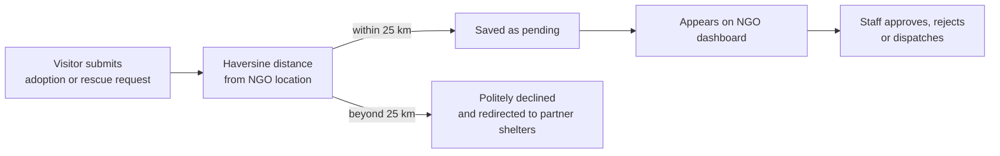

<div align="center">

# 🐾 Rise and Tails

### Every stray deserves a second chance.

A fast, compassionate web platform that connects animal lovers with a local rescue NGO, for **urgent rescue alerts** and **pet adoption**, all within a smart **25 km service radius**.


[Features](#-features) • [How it works](#-how-it-works) • [Tech stack](#-tech-stack) • [Getting started](#-getting-started) • [Database setup](#-database-setup) • [Admin panel](#-ngo-admin-panel) • [Roadmap](#-roadmap)

</div>

---

## 📸 Preview


| Home | Adopt | Urgent Rescue | NGO Dashboard |
|:---:|:---:|:---:|:---:|
| `assets/home.png` | `assets/adopt.png` | `assets/rescue.png` | `assets/dashboard.png` |

---

## ✨ Features

### 🐶 For adopters
- **Dogs or Cats**: a simple toggle to browse available pets
- **Pet cards** with photo, name and age, plus an **Adopt Me** button
- **Adoption application form**: name, email, phone, address, city, housing type and pet experience
- **Track your request**: check the status of an application or rescue alert on the `/track` page

### 🚨 For people who find an animal in need
- **No login, no sign-up**: built to be as fast as possible
- **One-tap GPS location** (or type an address)
- **Photo upload or short description**, plus a contact number
- Large, high-visibility **SEND URGENT RESCUE ALERT** button
- **Emergency Call** quick-dial button at the top of the page

### 🏠 For the NGO team
- **Secure admin login** with a server-checked, HTTP-only cookie session
- **Adoption Requests** tab: full applicant details, **Approve / Reject** actions and admin notes
- **Rescue Alerts** tab: live incoming alerts, with status *pending → dispatched → resolved*
- **Editable NGO settings**: location and service radius

### 📍 Smart 25 km service radius
Every request is checked with the **Haversine formula** against the NGO's location. Requests inside the radius go straight to the dashboard. Requests outside get a polite notice that they are redirected to a partner shelter network.

---

## 🔍 How it works



The radius check is enforced **inside the database** (a Postgres trigger), so it cannot be bypassed from the browser.

---

## 🧰 Tech stack

| Layer | Technology |
|---|---|
| Frontend | React, TypeScript, Tailwind CSS |
| Build tool | Vite |
| Backend functions | Server functions (admin login and data access) |
| Database | Supabase (PostgreSQL) |
| Security | Row Level Security (RLS), role-based access (`staff`) |
| Storage | Supabase Storage (private `rescue-photos` bucket) |
| Realtime | Supabase Realtime (live rescue alerts) |

---

## 🚀 Getting started

### Prerequisites
- [Node.js](https://nodejs.org/) (LTS version)
- npm (comes with Node.js)
- A free [Supabase](https://supabase.com/) account

### 1. Clone the repository

```bash
git clone https://github.com/YOUR_USERNAME/rise-and-tails.git
cd rise-and-tails
```

### 2. Install dependencies

```bash
npm install
```

### 3. Create your `.env` file

Create a file named `.env` in the project root (next to `package.json`):

```env
SUPABASE_PROJECT_ID="your-project-id"
SUPABASE_URL="https://your-project-id.supabase.co"
SUPABASE_PUBLISHABLE_KEY="your-publishable-key"
SUPABASE_SERVICE_ROLE_KEY="your-service-role-key"

VITE_SUPABASE_PROJECT_ID="your-project-id"
VITE_SUPABASE_URL="https://your-project-id.supabase.co"
VITE_SUPABASE_PUBLISHABLE_KEY="your-publishable-key"

ADMIN_SESSION_SECRET="a-long-random-string"
ADMIN_USERNAME="choose-a-username"
ADMIN_PASSWORD="choose-a-strong-password"
```

| Variable | Purpose |
|---|---|
| `SUPABASE_URL` | Your project's API URL (`https://<project-id>.supabase.co`) |
| `SUPABASE_PUBLISHABLE_KEY` | Public key, safe for the browser |
| `SUPABASE_SERVICE_ROLE_KEY` | **Secret** key used only on the server for the admin panel |
| `ADMIN_SESSION_SECRET` | Long random text used to sign the admin login cookie |
| `ADMIN_USERNAME` / `ADMIN_PASSWORD` | Your NGO admin login |

> ⚠️ **Never commit `.env`.** It contains secrets. Make sure `.env` is listed in `.gitignore`.

### 4. Run the project

```bash
npm run dev
```

Open the link shown in the terminal (usually `http://localhost:5173`).

---

## 🗄️ Database setup

Your Supabase project starts empty, so create the tables first.

1. **Create a storage bucket**: Supabase → **Storage → New bucket**. Name it exactly `rescue-photos` and keep it **private**.
2. **Run the migrations**: Supabase → **SQL Editor → New query**. Run the files inside `supabase/migrations/` **in order** (oldest first), one at a time.
3. **Set your NGO location**: the default is Mumbai, so change it to your NGO's coordinates:

   ```sql
   update public.ngo_settings
   set lat = YOUR_LATITUDE, lng = YOUR_LONGITUDE, radius_km = 25
   where id = 1;
   ```

4. **Create the first admin user**: Supabase → **Authentication → Users → Add user**. The **first user created automatically receives the `staff` role**, so do this before anyone else signs up.

You should now see these tables: `user_roles`, `ngo_settings`, `adoption_requests`, `rescue_alerts`.

---

## 🔐 NGO admin panel

Open **NGO Login** in the top-right corner of the site, or go to `/ngo`.

- Login is checked **on the server** and kept in a secure, HTTP-only cookie (8 hours).
- Set your own `ADMIN_USERNAME` and `ADMIN_PASSWORD` in `.env`. **Do not use default credentials in production.**
- The dashboard reads data through server functions, so `SUPABASE_SERVICE_ROLE_KEY` must be set on the server.

---

## 🛡️ Security notes

- Row Level Security is enabled on every table
- Only users with the `staff` role can read or update requests and alerts
- The service role key is never exposed to browser code
- Rescue photos are stored in a **private** bucket, readable only by staff
- Input length limits are enforced in the database

---

## 🗺️ Roadmap

- [ ] Restrict the public "track request" lookup so users see only their own requests
- [ ] Email or SMS notifications when a request is approved
- [ ] Admin screen to add, edit and remove pets
- [ ] Map view of rescue alerts for faster dispatch
- [ ] Partner shelter directory for out-of-radius requests
- [ ] Multi-language support (English, Hindi, Marathi)

---

## 🤝 Contributing

Contributions are welcome.

1. Fork the repository
2. Create a branch: `git checkout -b feature/amazing-feature`
3. Commit your changes: `git commit -m "Add amazing feature"`
4. Push the branch: `git push origin feature/amazing-feature`
5. Open a Pull Request

---

## 👤 Author

**YOUR NAME**
GitHub: [Uday Deshmukh](https://github.com/uday-d-d/)

---

## 💚 Acknowledgements

- Initial scaffolding generated with [Lovable](https://lovable.dev)
- Backend powered by [Supabase](https://supabase.com)
- Built to help the street animals of our city

<div align="center">

**If this project helps you, please give it a ⭐**

</div>
